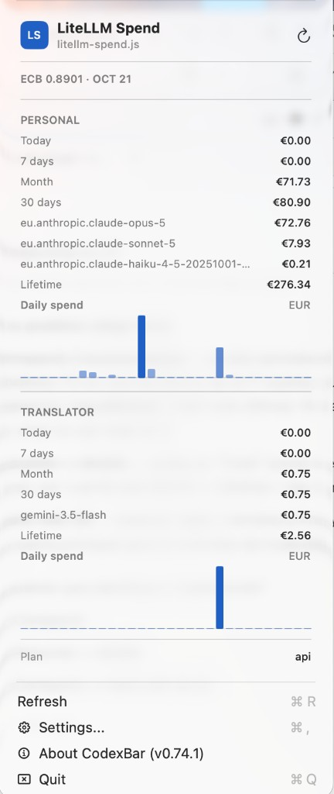

# CodexBar LiteLLM Spend

A [CodexBar](https://github.com/steipete/CodexBar) **provider plugin** that shows how much you have spent on a [LiteLLM](https://docs.litellm.ai/) proxy — across **up to 3 virtual API keys** — in the macOS menu bar.



## What this is for

Use this plugin when you have **several LiteLLM keys** (personal, team, different projects) and want a quick spend overview without opening the LiteLLM UI.

For each configured key it shows:

- Spend for **today**, **last 7 days**, **current month**, and **last 30 days**
- **Lifetime** spend
- Top models by cost
- A **daily spend** bar chart
- Amounts in **EUR** when possible (ECB USD→EUR rate via [Frankfurter](https://www.frankfurter.app/)); otherwise USD

### Why not use the built-in LiteLLM provider?

CodexBar already ships a **LiteLLM** provider. Use that when you have **one** virtual key and care mainly about **budgets / quotas** (personal and team limits, reset times).

This plugin exists because the built-in provider has these limits:

- **One API key only** — no multi-account spend in one place
- Focus on **budget windows**, not day / 7d / month / 30d spend charts per key
- Amounts stay in **USD** (no EUR conversion)
- Optional model activity, but not the multi-key spend breakdown this plugin shows

| | Built-in **LiteLLM** | This plugin (**LiteLLM Spend**) |
| --- | --- | --- |
| Keys | One | Up to three |
| Focus | Budgets / quotas | Spend over time + charts |
| Currency | USD | EUR when FX is available |

**Corporate / enterprise LiteLLM proxies** often add extra restrictions (limited endpoints, key permissions, no usable budget fields, blocked `/user/info` or `/team/info`, etc.). On those setups the **built-in provider may fail or show little useful data**, while this plugin leans on spend/report and activity endpoints that many virtual keys *can* call.

**Choose built-in LiteLLM** if you only need one key and budget %.  
**Choose LiteLLM Spend** if you want up to three keys with historical spend, charts, EUR when FX is available, or if the built-in provider does not work well against your corporate proxy.

## Install

1. Install and open [CodexBar](https://github.com/steipete/CodexBar).
2. Install the plugin file into CodexBar’s providers folder:

```bash
mkdir -p ~/.config/codexbar/providers
curl -fsSL -o ~/.config/codexbar/providers/litellm-spend.js \
  https://raw.githubusercontent.com/juansoilan/codexbar-litellm-spend/main/litellm-spend.js
```

Alternatively, download [`litellm-spend.js`](./litellm-spend.js) from this repo and copy it to `~/.config/codexbar/providers/litellm-spend.js`.

3. Quit and reopen CodexBar (or reload providers from Settings).
4. Open **Settings → Providers**, find **LiteLLM Spend**, and enable it.
5. When prompted, allow network access to your LiteLLM host and `api.frankfurter.dev`.

## Configure

In **Settings → Providers → LiteLLM Spend**, fill in:

| Setting | Required | Description |
| --- | --- | --- |
| **Base URL** | Yes | Origin of your LiteLLM proxy, e.g. `https://litellm.example.com` (no `/v1` suffix) |
| **Account 1–3 label** | No | Display name in the menu. If empty, the plugin uses the key’s LiteLLM alias |
| **Account 1–3 API key** | At least one | LiteLLM virtual key (`sk-…`) |

You can leave Account 2 and 3 empty if you only need one key.

Your keys must be allowed to call LiteLLM endpoints such as `/key/info` and spend/activity reports.

## Security notes

- Keep API keys private. Do not commit them or paste them into public issues.
- Key fields are stored as plain CodexBar settings so each account can use its own `Authorization` header.

## License

MIT — see [LICENSE](./LICENSE).
